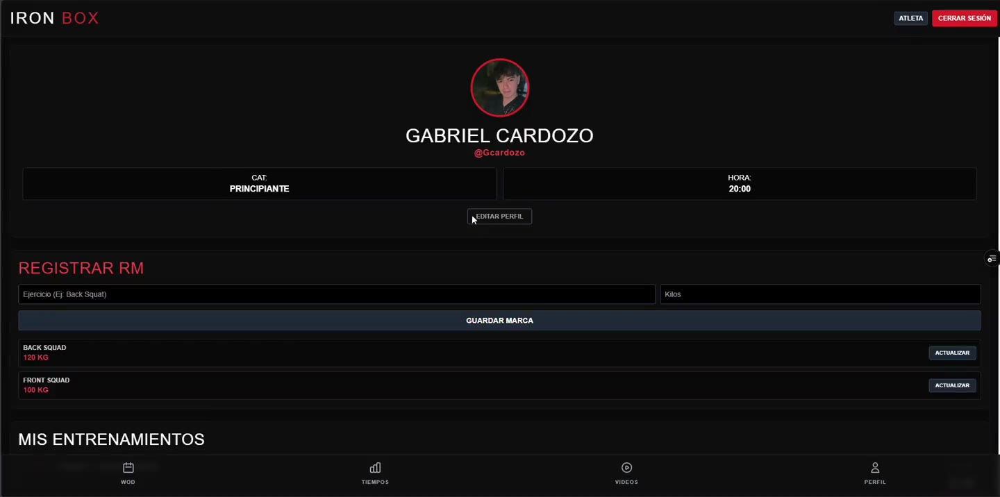

# Plataforma Ironbox

Aplicación web para un box de CrossFit, con perfiles separados para coaches y atletas. Los coaches cargan el WOD del día y los videos de técnica; cada atleta registra sus tiempos y sus RM y sigue su progreso.



[Ver el video de la demo en mi portafolio](https://sergio-cardozo.vercel.app/#p-ironbox)

## Qué hace

- Registro e ingreso con perfiles de coach (profesor) y atleta, con foto, categoría y horario de clase.
- WOD del día, cargado por el coach para cada fecha.
- Carga de tiempos o puntajes del WOD y tabla del día por categoría. Cada atleta puede corregir solo sus propios resultados.
- Historial de resultados por fecha y registro de RM (récord personal) por ejercicio.
- Biblioteca de videos para ver la técnica de cada ejercicio.

## Tecnologías

Node.js · Express · Prisma · PostgreSQL · JavaScript · HTML · Tailwind CSS · Vercel

## Cómo ejecutarlo

Necesitás [Node.js](https://nodejs.org) en su versión LTS y Docker (o una base PostgreSQL propia).

```bash
cp .env.example .env        # completar la contraseña de la base
docker compose up -d        # levanta PostgreSQL
npm install
npx prisma migrate deploy   # crea las tablas
npm start
```

## Seguridad

- Las contraseñas se guardan cifradas con scrypt y una sal aleatoria, y la API nunca las devuelve.
- Los datos de conexión se leen de variables de entorno; no hay claves en el código.

Es un proyecto de aprendizaje. Para usarlo con un box real, el siguiente paso sería manejar la sesión con tokens del lado del servidor, en lugar de confiar en el usuario que envía el navegador.

## Autor

**Sergio Cardozo**, desarrollador full stack en Formosa, Argentina.
[Portafolio](https://sergio-cardozo.vercel.app) · [LinkedIn](https://www.linkedin.com/in/sergiocardozo-dev) · [GitHub](https://github.com/Gabicrdz)
